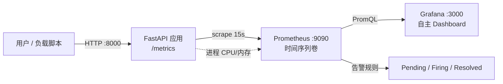

# 实验 08 · 软件运行监控与可观测性平台

## 一句话简介

基于 FastAPI + Prometheus 3.14.0 + Grafana 13.2.1 的轻量可观测性演示平台：应用暴露请求计数、延迟分布与进程资源指标，Prometheus 按 15s 抓取，Grafana 自主设计 6 面板 Dashboard，并通过受控负载、延迟注入与停机实验验证指标能否支持诊断。

- 汇报人：隋圣丹　学号：23120506078　班级：软件 2302
- 课程：《开源软件与新技术》实验 08

## 1. 目标用户与问题场景

面向本机开发/演示环境：服务启动后，需要回答「何时变慢、影响多大、哪个组件异常」。在没有指标时只能靠用户报错后翻日志猜测；本平台用请求计数、延迟分布、错误率、进程 CPU/内存与存活状态形成从应用状态到工程判断的闭环。

### 功能清单

- FastAPI 应用暴露 `/metrics`，含请求 Counter、延迟 Histogram、进程 CPU/内存指标。
- Prometheus 抓取配置、持久化目录与两条告警规则（实例下线、p95 过高）。
- Grafana 数据源与 Dashboard 通过 provisioning 自动加载，6 个面板：服务状态、请求速率、状态码速率、p50/p95 延迟、进程 CPU、进程内存。
- 受控负载脚本（限并发、限总次数、限延迟与错误占比）。
- pytest 测试集：指标、配置、PromQL、Dashboard、异常边界五类。

## 2. 技术栈与系统架构

| 组件 | 固定版本 | 用途 | 许可证 |
|---|---|---|---|
| Python | 3.11 / 3.12 | 演示应用与测试运行时 | PSF |
| FastAPI | 0.115.12 | Web 框架与中间件 | MIT |
| uvicorn | 0.34.3 | ASGI 单 worker 服务 | BSD-3-Clause |
| prometheus-client | 0.22.1 | Python 指标暴露库 | Apache-2.0 |
| psutil | 7.0.0 | Windows 进程 CPU/内存补充采集 | BSD-3-Clause |
| Prometheus | 3.14.0 | 指标抓取、TSDB 存储与 PromQL 查询 | Apache-2.0 |
| Grafana OSS | 13.2.1 | 数据源接入与 Dashboard 可视化 | AGPL-3.0 |
| pytest | 9.2.0 | 自动化测试 | MIT |



架构说明：应用暴露原始累计指标，Prometheus 计算速率与窗口聚合；请求数用 Counter，当前状态用 Gauge，延迟分布用 Histogram；标签只取有界集合（方法、模板路由、状态）；Grafana 只查询 Prometheus，不直接拉应用数据。

## 3. 环境要求与版本检查

- 端口占用检查：8000（应用）、9090（Prometheus）、3000（Grafana）需空闲。
- Python 3.11/3.12；Git 2.40+。
- 路线 A（原生 Windows，本仓库默认路线）：另行下载 Prometheus 3.14.0 与 Grafana 13.2.1 的 Windows ZIP（见第 7 节）。
- 路线 B（容器，可选）：Docker + Compose。

版本检查命令：

```powershell
python --version
git --version
```

## 4. 安装、配置、运行与停止

### 路线 A：原生本机（推荐复现路线）

1. 进入项目目录并创建虚拟环境：

```powershell
cd "D:\bug management\observability-lab"
python -m venv .venv
.\.venv\Scripts\Activate.ps1
python -m pip install -r requirements.txt
```

2. 下载上游二进制（不纳入 Git 仓库）：
   - Prometheus 3.14.0：https://github.com/prometheus/prometheus/releases/tag/v3.14.0 ，解压后设置环境变量 `PROMETHEUS_HOME` 指向解压目录（含 `prometheus.exe`、`promtool.exe`）。
   - Grafana OSS 13.2.1：https://grafana.com/grafana/download ，解压后设置环境变量 `GRAFANA_HOME` 指向解压目录（含 `bin\grafana.exe`）。

3. 启动应用（窗口 1）：

```powershell
.\scripts\start-app.ps1
```

4. 校验并启动 Prometheus（窗口 2）：

```powershell
.\scripts\start-prometheus.ps1
```

5. 启动 Grafana（窗口 3）：

```powershell
.\scripts\start-grafana.ps1
```

6. 访问地址：
   - 应用指标：http://127.0.0.1:8000/metrics
   - Prometheus Targets：http://localhost:9090/targets （确认 `demo-app` 为 UP）
   - Grafana：http://localhost:3000 （首次登录 admin / admin，按提示改密；数据源 URL 为 `http://127.0.0.1:9090`）

停止：在各窗口按 `Ctrl+C`；Prometheus 数据落在 `data/prometheus/`，Grafana 数据由其安装目录数据卷保存。

### 路线 B：Docker Compose（可选）

```powershell
docker compose up -d
```

容器路线注意：Prometheus 配置使用 `prometheus/prometheus-compose.yml`（target 为 `app:8000`）；Grafana 数据源 URL 需改为 `http://prometheus:9090`（修改 `grafana/provisioning/datasources/prometheus.yml`）。两条路线不要同时运行。

## 5. 最小演示流程

1. 启动三服务后，先手工访问 http://127.0.0.1:8000/api/items 约 20 次。
2. 在 Prometheus 查询 `up{job="demo-app"}` 确认返回 1；查询 `sum(rate(http_requests_total{job="demo-app"}[1m]))` 观察速率。
3. 打开 Grafana「实验08 · 应用运行监控 Dashboard」，确认 6 个面板均有曲线。
4. 运行受控负载：

```powershell
python scripts/load_test.py --total 200 --concurrency 4 --delay-ms 0
python scripts/load_test.py --total 200 --concurrency 4 --delay-ms 300 --error-ratio 0.1
```

5. 停止应用进程，观察 `up` 与 `AppInstanceDown` 告警的 Pending → Firing；重启应用后观察 Resolved。

## 6. 测试方法、结果与已知问题

### 运行测试

```powershell
.\scripts\run-tests.ps1
# 或
python -m pytest tests -q
```

测试覆盖：指标单元/集成（Counter/Histogram/错误计数/标签基数）、配置校验（Prometheus/告警/数据源）、PromQL（速率/错误率/p95/资源口径）、Dashboard（面板数/单位/数据源/时间窗）、异常边界（参数钳制/时间线文档）。

### 已知问题与边界

- 原生 Windows 下默认 ProcessCollector 不提供进程 CPU/内存，本仓库通过自定义 Collector 补充；测量口径为当前进程，不是整机。
- 单 uvicorn worker 启动，避免多进程指标聚合（multiprocess）问题。
- 样本量过少时 Histogram 分位数可能无数据，需先产生受控流量。
- 指标只能证明可观测到的现象，不能单独证明根因；CPU 与 p95 同时升高也不能直接断言 CPU 是根因。

## 7. 二次开发内容（与上游基线的差异）

上游 Prometheus / Grafana / client_python 提供抓取、存储、查询与绘图能力；本人实现范围：

- FastAPI 中间件：请求计数与延迟埋点，模板路由标签，排除 `/metrics` 自身流量。
- Windows 自定义进程 Collector：仅 win32 注册，补充 CPU 秒数与 RSS 字节。
- 指标设计表：名称/类型/单位/标签/桶/问题与高基数审查（`metrics_design.md`）。
- PromQL 设计：速率、状态码分组、错误率、p50/p95、CPU 与内存查询及窗口口径。
- 自主 Dashboard：6 面板的单位、Legend、阈值与时间窗口，provisioning 自动加载。
- 受控异常脚本与异常时间线分析；五类自动化测试。

## 8. 个人开发记录与贡献证据

- 分支：`main` 与 `feature/observability-dashboard`；提交分层覆盖基线、埋点与采集、自主面板、测试与文档。
- 至少 5 个可解释 Commit，PR 关联对应 Issue；合并前完成一次有文字记录的自审核对。
- 提交记录核对命令：

```powershell
git log --oneline --graph --decorate --all -n 30
git shortlog -sne HEAD
```

## 9. 上游项目、第三方资源与 License

| 项目 | 链接 | 许可证 |
|---|---|---|
| Prometheus | https://github.com/prometheus/prometheus | Apache-2.0 |
| Grafana OSS | https://github.com/grafana/grafana | AGPL-3.0 |
| client_python | https://github.com/prometheus/client_python | Apache-2.0 |

第三方代码、数据、图片与主题来源在 `NOTICE.md` 登记；对外发布时选择与上游兼容的许可证，AGPL 项目的网络部署版本保留许可证与源码提供义务说明。

## 10. 安全注意事项

- 负载脚本仅请求本机 `127.0.0.1:8000`，禁止对非本人或未授权系统压测。
- 仓库不提交密码、Token、数据库口令与大文件；Grafana 首次登录密码及时修改。
- 演示端点 `/api/error` 仅用于错误率观测，不对外暴露。

## 11. 两阶段启动检查点

- 课前基线：应用可运行、`/metrics` 有五类数据、指标设计表完成、负载脚本就绪。
- 课中前半段：Prometheus Targets 为 UP，基础 PromQL 有数据。
- 课中后半段：Dashboard 6 面板有曲线，完成负载/延迟/停机实验并记录时间线。
- 课后完善：告警验证、Dashboard 导出、重启复现、测试证据与 PPT 材料。

## 12. 主要截图（运行后采集，存入 docs/evidence/）

| 编号 | 内容 | 对应 PPT 页 |
|---|---|---|
| S1 | `/metrics` 原始指标片段（Counter / Histogram / 进程指标） | 第 5 页 |
| S2 | Prometheus Targets 页面 `demo-app` 为 UP | 第 5 页 |
| S3 | 自主 Dashboard 全貌：6 个面板与图例、单位 | 第 8 页 |
| S4 | 受控负载期间请求速率与 p95 曲线变化 | 第 9 页 |
| S5 | 停止/恢复应用时 `up` 与告警 Pending/Firing/Resolved 状态 | 第 9 页 |
| S6 | 测试运行输出（pytest 25 passed，退出码 0） | 第 10 页 |
